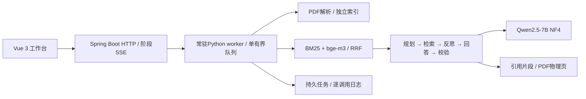

# DocMind · 论文问答工作台

上传文本PDF，在指定论文范围内提问，并打开回答引用的原文片段和PDF物理页核对。

**本地试用版本**：Python + Spring Boot + Vue 3；支持显式演示模式及本地Qwen2.5-7B真实模型。模型权重和用户论文单独保存在本机。

## 能力

- PDF版面信息解析与结构切分，上传独立索引、SHA256去重和索引完整性校验。
- BM25 + bge-m3双路召回，RRF融合；最多选择10篇论文限定检索范围。
- 手写Agent规划、检索、反思、回答、校验；最大轮次与生成token预算控制。
- 有界队列、任务状态和协作取消、持久任务历史、逐调用日志、真实阶段SSE。
- Vue工作台展示引用全文、原PDF物理页与翻页缩放，支持任务导出。

## 快速试用（Windows）

安装Python 3.11或以上、Java 21、Node.js（含npm）及Apache Maven并加入PATH。完整步骤：[试用指南](docs/TRYOUT.md)。

```powershell
python -m venv .venv
.venv\Scripts\python.exe -m pip install -r requirements-demo.txt
.venv\Scripts\python.exe scripts/check_environment.py
.venv\Scripts\python.exe scripts/build_frontend.py
service\mvnw.cmd -f service/pom.xml package
powershell -NoProfile -ExecutionPolicy Bypass -File scripts/start_docmind.ps1 -Backend stub -ServicePort 8088 -WorkerPort 8788
```

打开 `http://127.0.0.1:8088`。演示模式可体验上传、索引进度、任务和页图；固定回答显著标注STUB，演示向量是占位数据，不体现语义检索或模型效果。

真实问答需额外安装CUDA模型依赖、下载bge-m3与Qwen权重，然后启动默认real模式。已在RTX 5060 8GB上验证Qwen NF4；其他显卡/驱动组合需要自行验证。首次安装依赖和下载模型需要联网，模型在本地执行。

## 架构



## 验证与边界

[测试说明](docs/TESTING.md) · [简历与面试说明](docs/RESUME.md) · [第三方说明](THIRD_PARTY_NOTICES.md)

模型自检通过不保证事实正确。已通过3篇公开论文9道便利样本的原文辅助核对，发现措辞矛盾、误导引用及自检误判；这不是整体准确率或训练未见盲测。历史评测及私人论文不随源码发布。

当前处理文本PDF（20MB、200页、1200片段上限），扫描件需要先OCR。没有页内矩形高亮、账号/多租户及公网服务。SSE推送执行阶段，不逐token推送；运行中取消在模型调用后生效。服务默认只监听回环地址，面向个人本地使用。

## 源码与许可

本项目源码采用GNU AGPL-3.0-or-later，见[LICENSE](LICENSE)。模型权重及第三方组件遵循各自许可。仓库不包含模型权重、用户上传文件、日志或个人评测记录。
