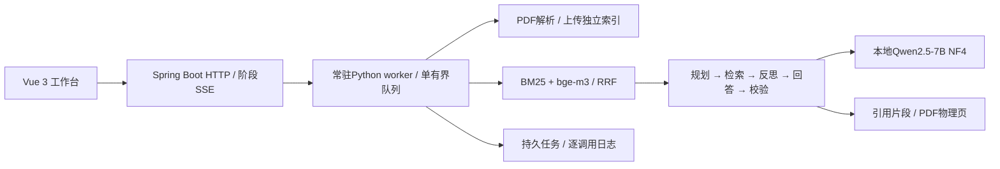

# 技术架构

Python / PyMuPDF / BM25 / bge-m3 / NumPy / Qwen2.5-7B NF4 / Spring Boot / Vue 3。

上传按SHA256去重并验证索引完整性；选择范围按文档ID合并两路索引。embedding在CPU共享，Qwen使用GPU量化推理。有界队列及协作取消避免无约束执行；日志记录调用输入输出、耗时和终止原因。

Agent使用手写控制流程。校验只报告结果，不保证事实正确或自动修订答案。SSE传递真实执行阶段，当前不是逐token输出。演示模式明确返回固定模拟答案，上传向量仅用于验证流程。

当前以小规模本地文献阅读为目标。未接入OCR、多模态解析、账号、多租户或公网部署。模型权重单独下载，安装见[试用指南](TRYOUT.md)，测试范围见[测试说明](TESTING.md)。
